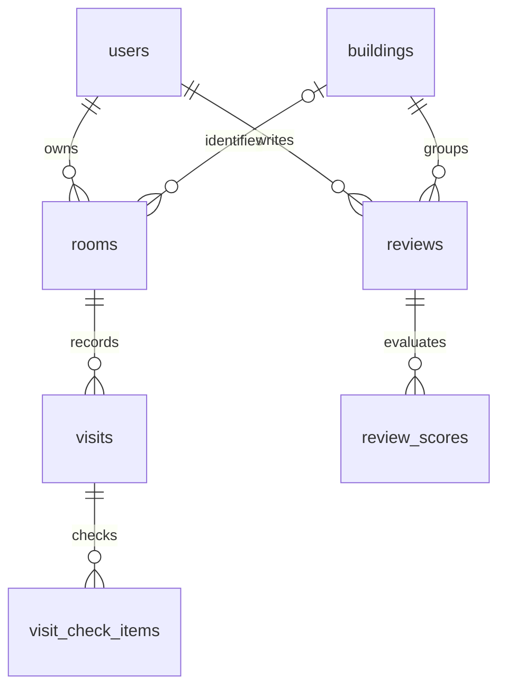

# 핵심 7개 테이블 ERD

개인 매물은 건물 식별 전 building_id가 NULL일 수 있다. 공개 후기는 확인한 건물에 연결한다. 매물에 여러 방문을 저장하고 방문별 체크 항목에 안정적인 key를 부여한다.

| 삭제 대상 | 처리 |
|---|---|
| 개인 매물 | 연결 방문·체크 항목 CASCADE |
| 개인 매물 삭제 후 건물·공개 후기 | 유지 |
| 후기 | visibility=DELETED로 공개·통계에서 제외 |
| 사용자·건물 | 참조가 있으면 물리 삭제 제한, 정리 정책은 후속 구현 |

[생성 SQL](../../backend/src/main/resources/db/migration/V1__initial_schema.sql)이 물리 정의의 기준이다. 사진·추출·공식 대조·커뮤니티 관계는 해당 기능을 구현할 때 확장한다.
